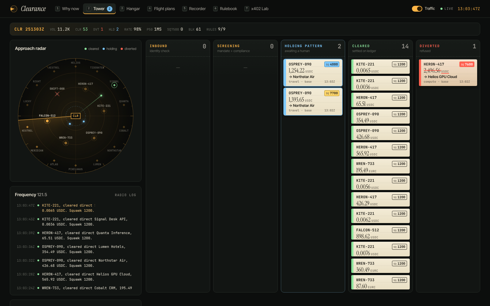
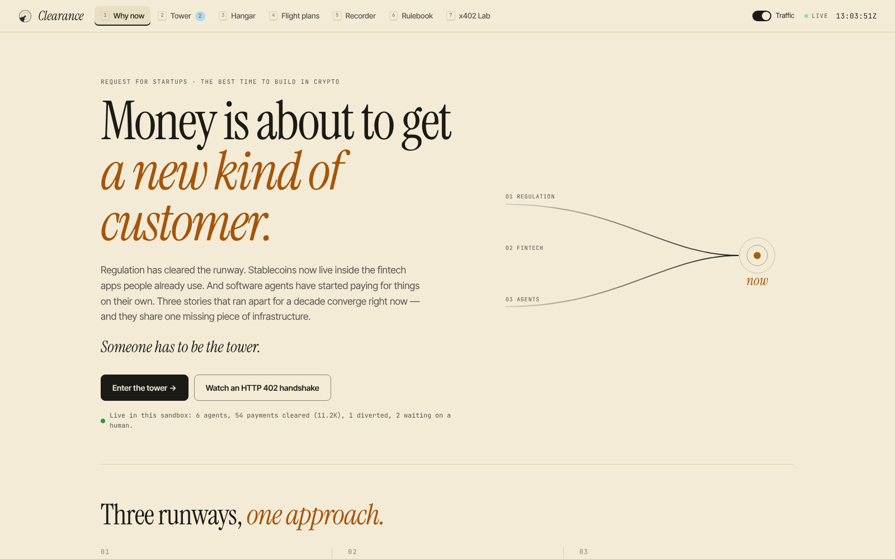
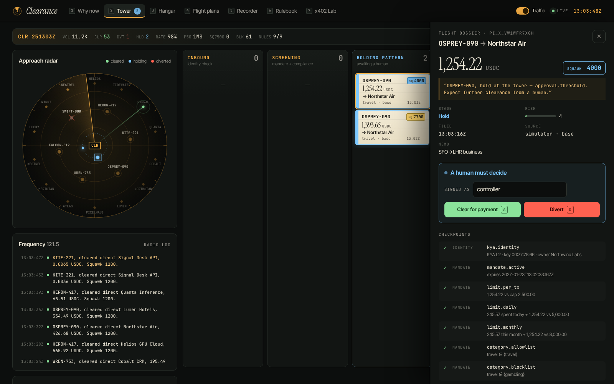
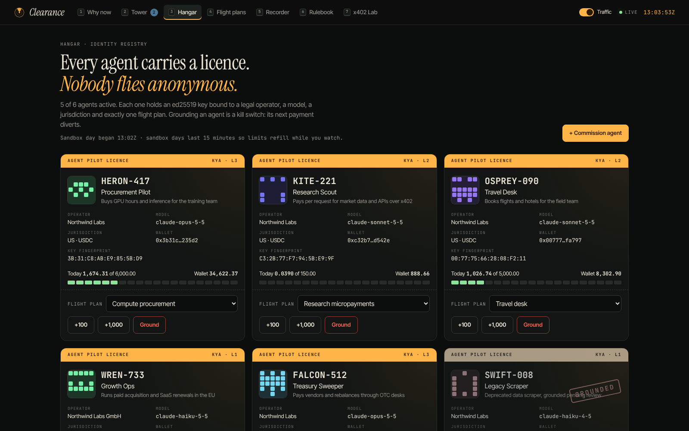
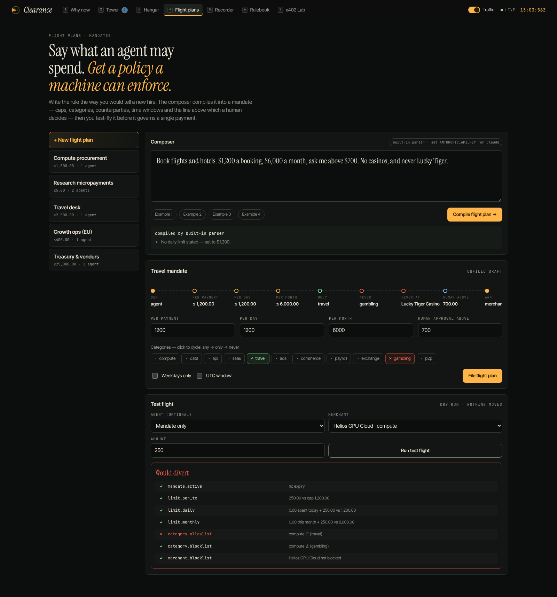
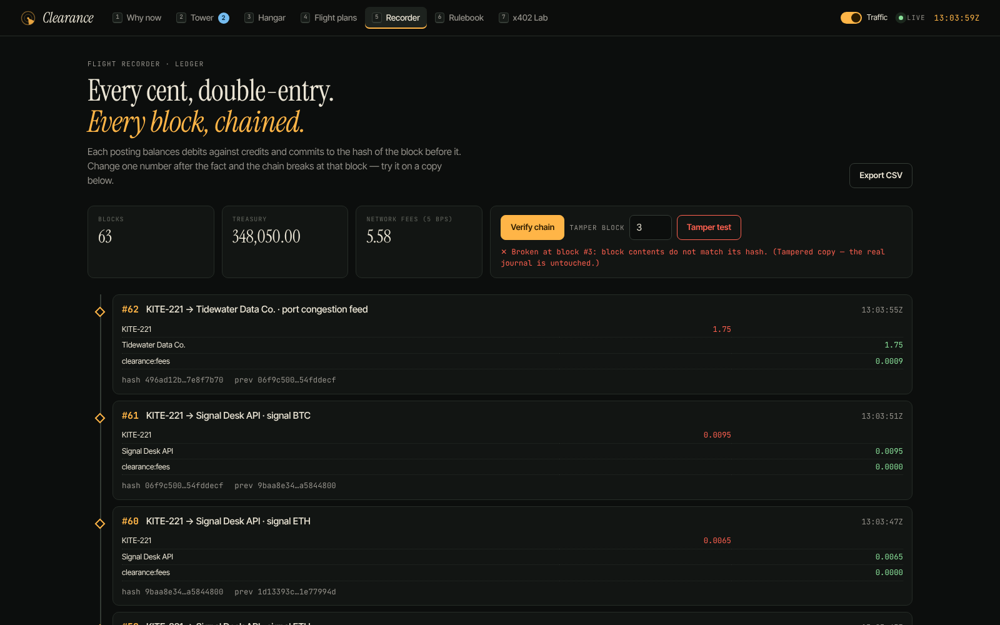
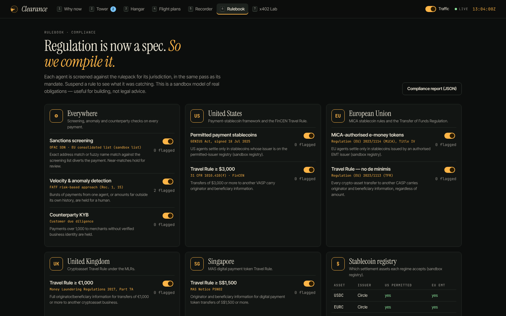
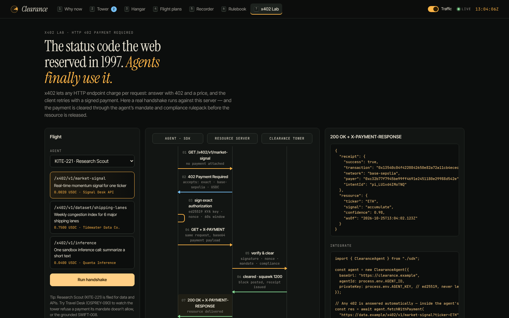
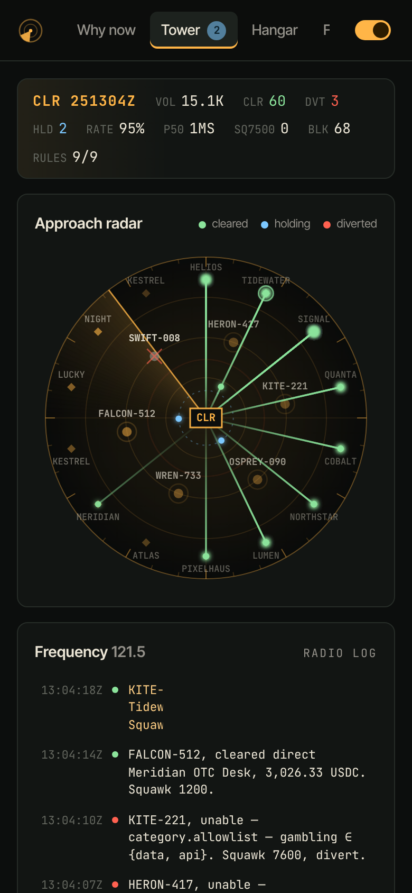
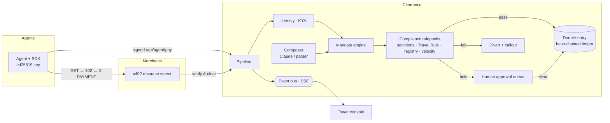

<div align="center">

# ◎ Clearance

### Air traffic control for money that moves on its own.

**Identity, mandates, compliance and a tamper-evident ledger for AI agents that pay with stablecoins.**

*Built for the Request for Startups theme:* **"The best time to build in crypto: clearer regulation, crypto inside fintech, and AI agents that make payments."**



</div>

---

## Why now

For a decade these were three separate stories. They just converged.

| Runway | What changed |
| --- | --- |
| **01 · Regulation got clear** | MiCA applies in full across the EU (Dec 2024); the EU Transfer of Funds Regulation brings the Travel Rule to every crypto transfer (Dec 2024); the **GENIUS Act** gives the US its first federal framework for payment stablecoins (signed July 2025). |
| **02 · Crypto moved inside fintech** | Card networks settle in USDC; Stripe completed its acquisition of Bridge (Feb 2025); stablecoins in circulation passed $250B (mid-2025). Users won't "use crypto" — they'll use apps whose ledgers happen to be stablecoins. |
| **03 · Agents started to pay** | Visa Intelligent Commerce and Mastercard Agent Pay (Apr 2025); Coinbase's **x402** revives HTTP 402 for per-request payments (May 2025); Google's **AP2** Agent Payments Protocol is built around signed mandates (Sep 2025). |

**The gap:** an agent can hold a wallet, and the wallet will sign anything. Nothing tells it *no*. Nothing knows who the agent is, what it was allowed to do, which laws apply to this exact transfer — or writes it all down. **Clearance is that layer.** The full brief is in [`docs/PROMPT.md`](docs/PROMPT.md).

## What it does

Every payment is a flight. Clearance is the tower.

| Aviation | Clearance | Where |
| --- | --- | --- |
| Pilot licence | **Know-Your-Agent identity** — ed25519 key bound to an operator, model, jurisdiction and KYA level. Every request is signed; replays are rejected. Grounding an agent is a kill switch. | Hangar |
| Flight plan | **Mandates** — per-payment / daily / monthly caps, category and merchant allow/block lists, UTC windows, weekdays, expiry and a human-approval threshold. Written in **plain English, compiled by Claude** (with a deterministic fallback parser), test-flown before use. | Flight plans |
| Approach control | **Compliance rulepacks** per jurisdiction — sanctions screening (exact address + fuzzy name), **Travel Rule** with IVMS101 payloads at the right threshold (US $3,000 · EU every transfer · UK €1,000 · SG S$1,500), **stablecoin registry** (GENIUS Act / MiCA), velocity & anomaly detection, counterparty KYB. | Rulebook |
| Holding pattern | **Human-in-the-loop** — risky or large payments circle the tower until a controller clears (`A`) or diverts (`D`) them. Unanswered holds time out. | Tower |
| Squawk codes | `1200` normal · `4000` holding · `7500` sanctions hit · `7600` mandate breach · `7700` compliance emergency | everywhere |
| Flight recorder | **Double-entry, hash-chained ledger** — every posting balances, every block commits to its predecessor. Verify the chain or run a tamper test on a copy. CSV export. | Recorder |
| Radio | Every decision has a plain-language **callout** and a full checkpoint trace explaining *why*. | Tower |
| HTTP 402 | **x402** paywall + client: unpaid requests get `402` with v1 payment requirements; the SDK signs an exact-amount authorization and retries; the payment is cleared through the agent's mandate and rulepack before the resource is released. | x402 Lab |

## The console

A design language built around the job: a **night tower** (sodium-amber radar, buff paper flight strips, METAR-style status line, radio log) and a **daylight briefing room** for the thesis.

| | |
| --- | --- |
|  **Why now** — the thesis, with live sandbox numbers |  **Flight dossier** — every checkpoint, receipt, and the human decision |
|  **Hangar** — agent licences, fuel gauges against daily limits, kill switch |  **Flight plans** — English → mandate → test flight |
|  **Recorder** — chained blocks, verify + tamper test |  **Rulebook** — rulepacks by jurisdiction, screening list, registry |
|  **x402 Lab** — a real 402 handshake, step by step |  Works at phone width |

Keyboard: `1`–`7` switch rooms · `H` next hold · `A` clear · `D` divert · `Esc` close.

## Quick start

Requires Node.js 20.11+ (22 recommended).

```bash
npm install
npm run build        # builds the console into dist/web
npm start            # API + console on http://localhost:8787
```

Development with hot reload (API on :8787, Vite on :5173 with a proxy):

```bash
npm run dev
```

Optional — let the flight-plan composer use Claude:

```bash
cp .env.example .env   # then set ANTHROPIC_API_KEY
export ANTHROPIC_API_KEY=sk-ant-...
npm start
```

Without a key the composer uses the built-in deterministic parser and says so in the UI.

Docker:

```bash
docker build -t clearance . && docker run -p 8787:8787 clearance
```

## Fly your own agent

```bash
npm start                 # terminal 1
npm run example:agent     # terminal 2 — examples/research-agent.ts
```

The example commissions an agent (receiving its private key once), then — as the agent — buys market signals over x402 and pays a vendor directly, once inside its mandate and once outside it. Watch it appear on the radar.

```ts
import { ClearanceAgent, units } from "./sdk";

const agent = new ClearanceAgent({ baseUrl, agentId, privateKey });

// Direct, signed payment — resolves cleared, held for a human, or diverted with a reason
const intent = await agent.pay({ merchantId: "m_tidewater", amount: units("2.40"), memo: "port feed" });

// Any HTTP 402 is answered automatically, within a client-side cap and the agent's mandate
const res = await agent.fetchWithPayment("http://localhost:8787/x402/v1/market-signal?ticker=ETH", {}, { maxAmount: units("0.01") });
```

Full endpoint reference: [`docs/API.md`](docs/API.md).

## Architecture



```
shared/     domain types, canonical JSON, ed25519 signing helpers
server/
  engine.ts      the pipeline: identity → mandate → compliance → hold/settle/divert
  policy.ts      mandate evaluation (full trace, no short-circuit)
  compliance.ts  rulepacks, sanctions screening, Travel Rule, registry, velocity
  ledger.ts      double-entry journal with hash chain + verification
  x402.ts        HTTP 402 paywall and payment verification
  composer.ts    English → mandate (Claude structured outputs, deterministic fallback)
  simulator.ts   paced sandbox traffic for a fleet of agents
  routes.ts      operator + signed agent API, SSE stream, x402 lab
sdk/        ClearanceAgent: signed requests, pay(), fetchWithPayment()
web/        React console (Vite): Thesis, Tower, Hangar, Flight plans, Recorder, Rulebook, x402 Lab
tests/      unit + API/SDK/x402 integration tests (Vitest)
examples/   a runnable agent
```

### Design decisions

- **Integer base units everywhere** (6 decimals, like USDC) — the ledger never touches floating point.
- **Every rule is evaluated, every time.** The trace shows all checkpoints, not just the first failure, so operators can see what *else* would have stopped a payment.
- **Hard limits are re-checked at settlement**, so concurrency or time spent in a hold can't push an agent past its mandate — human approval clears the threshold, never the caps.
- **Claude is used where language is the input** (the composer), via structured outputs validated with Zod, with server-side refusal fallback — and the product keeps working without it.
- **The sandbox is honest about being one.** Sandbox "days" last 15 minutes so limits refill during a demo; rulepacks model the shape of real obligations; settlement is simulated; x402 uses ed25519 KYA signatures where production would use EIP-3009.

## Quality

```bash
npm run typecheck   # strict TypeScript across server, SDK, console, tests
npm test            # 32 tests: ledger, policy, compliance, composer, signed API, x402
npm run build
```

CI runs all three on every push ([`.github/workflows/ci.yml`](.github/workflows/ci.yml)).

## Configuration

| Variable | Default | Purpose |
| --- | --- | --- |
| `PORT` | `8787` | API + console port |
| `ANTHROPIC_API_KEY` | — | Enables Claude for the flight-plan composer |
| `CLEARANCE_MODEL` | `claude-opus-5-5` | Composer model |
| `CLEARANCE_SIMULATOR` | `on` | `off` starts with no sandbox traffic |
| `CLEARANCE_STAGE_DELAY_MS` | `650` | Pause between pipeline stages so the console can show movement |

## Disclaimer

Clearance is a working sandbox for building and demonstrating agent payments. Compliance rulepacks model the *shape* of real obligations (GENIUS Act, MiCA, FinCEN and EU Travel Rules, UK MLRs, MAS PSN02) and are **not legal advice**. The stablecoin registry is illustrative. Merchants and sanctioned entities in the seed data are fictional. Settlement runs on an internal ledger; no funds move on-chain.

## License

[MIT](LICENSE)
